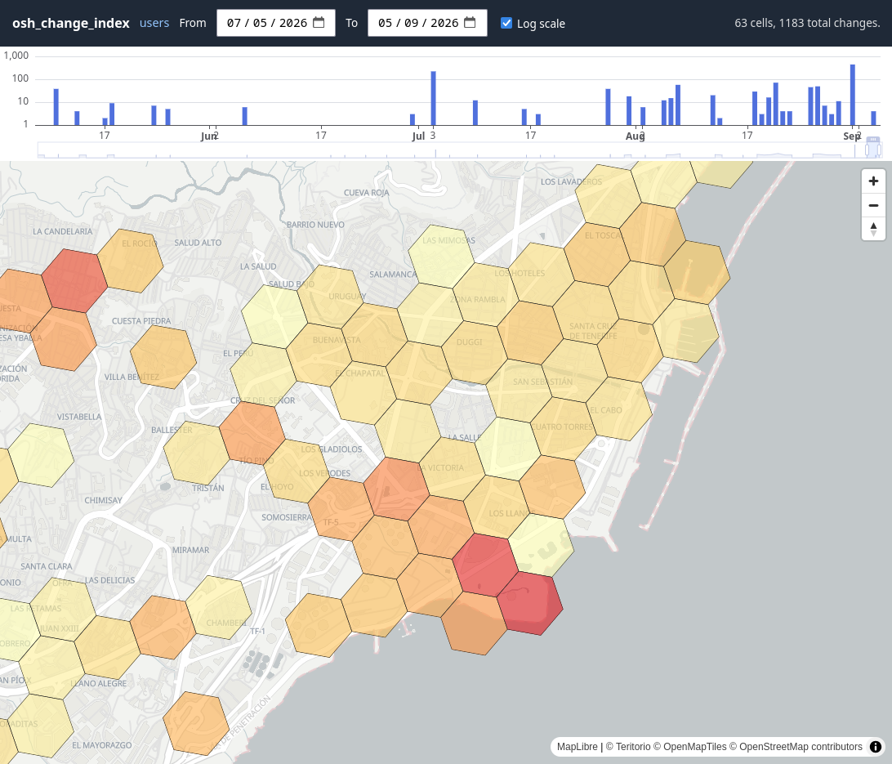
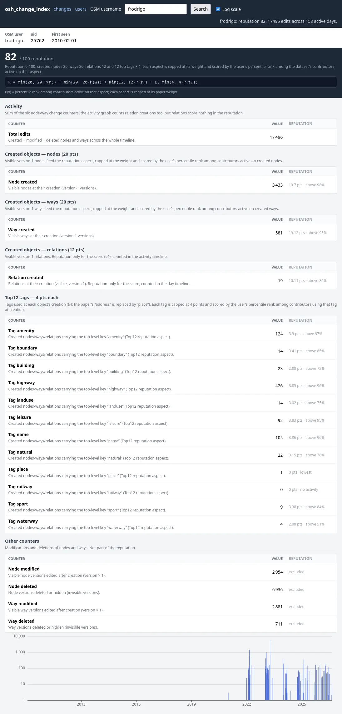

# KarmaMap

KarmaMap reads an OSM full-history file (`.osh.pbf`) and produces one
partitioned Parquet change map - `changes/` - with `(h3_cell, change_date,
count)` rows (node + way changes merged per cell per day), partitioned by
calendar year
(`year=YYYY/data.parquet`, standard hive partitioning), for
bbox + date-range queries (e.g. with DuckDB or the included web frontend).
The `count` of a cell on a day sums the node changes and the way changes, in
the same file per year so a client reads one dataset per year. The
users-history pass adds the karma layer: per-user, per-day activity
and a 0-100 ranking per contributor.

The output is queried directly in the browser by two static viewers shipped
in `web/`: a changes map + histogram, and a per-user ranking viewer. The
ranking scoring follows [Neis, Goetz & Zipf, *ISPRS Int. J. Geo-Inf.*
2012, 1(3), 315-332](https://www.mdpi.com/2220-9964/1/3/315).

## What it produces

- `changes/` — `(h3_cell, change_date, count)` counts (node + way changes
  merged per cell per day), partitioned by calendar year.
- `users_history.parquet` and `user_ranking.parquet` — per-user, per-day
  activity and ranking, built by every run; the history file also
  carries the per-day suspect flags (a `suspect_flag` column): bit 0 = filter 2
  (edit burst > 500/h), bit 1 = filter 3 (node move > 500 m), bit 2 = filter 1
  (ranking < 5%), bit 3 = filter 4 (spatial spread of H3 cells in 1h window;
  not from the original OSMPatrol paper), bit 4 = filter 5 (one tag key on
  >90% of modified/deleted objects in a 1-hour window with ≥ 100 total; local
  extension).
- Suspect-screen outputs of every `update` run: `suspect_minutes.bin` (the
  persisted per-`(uid, minute)` modified+deleted bucket store behind filter 2),
  `suspect_cells.bin` (the persisted per-`(uid, minute, h3_cell)` modified+deleted
  bucket store behind filter 4), `suspect_tags.bin` (the persisted per-`(uid, minute, tag_key)`
  modified+deleted bucket store behind filter 5), the bit-coded per-day `suspect_flag` in
  `users_history.parquet` (filters 2/3 have no persisted node-moves dataset —
  they survive only as carried day bits, and bit 2 is forward-only too: import
  writes 0 and updates set it only on the new rows they write for a
  below-threshold contributor — once set, never removed), and `suspect.parquet`
  — an update-only re-export of the flagged days carrying each day's total
  change count, the peak edit count, spread and tag keys its filter fired on,
  its far-move count with the largest of them and the ranking frozen at the
  day's first flag.





## Documentation

- [HOW_IT_WORKS.md](HOW_IT_WORKS.md) — the internal pipeline: passes,
  business rules, resolution, node cache and the users-history
  pass, plus how the bundled web viewers query the data.
- [API.md](API.md) — the Parquet data contract (layout, schemas, encodings)
  for reusers.

## Setup

### Requirements

- Docker with Compose.
- An OSM full-history file (`.osh.pbf`).
- Disk space for the node cache and the Parquet output.

### Configuration

Host paths are read from a `.env` file (see `.env.template`) and used by
`docker-compose.yml`. `DATA_DIR` is mounted at `/data` for the
`karmamap` service — the input file and the `--node-cache` and `--output-dir`
paths are absolute under it — and the `caddy` service serves the
`${DATA_DIR}output` subdirectory read-only at `/data/`. `--output-dir`
defaults to `$DATA_DIR/output` (`data/output` when run bare on the host;
`/data/output` in the container, since compose passes `DATA_DIR=/data`), so
pointing it elsewhere leaves nothing for the web frontend.

```bash
cp .env.template .env
```

```
DATA_DIR=./data/
```

Without a `.env`, the compose defaults `DATA_DIR=./data/` (mounted at `/data`)

Point `--update-url` (or a later diff-update download) at the Geofabrik
*internal* server (`osm-internal.download.geofabrik.de`)? Its extracts carry
user/changeset metadata and full history for OSM contributors only, so it
sits behind an OSM session cookie. Add the OSM account to the same `.env`:

```
OSM_GEOFABRIK_USER=my_osm_login
OSM_GEOFABRIK_PASSWORD=my_osm_password
```

karmamap performs Geofabrik's OAuth2 cookie dance itself from these
credentials, caches the session in the Netscape jar
`<node-cache-parent>/.geofabrik.cookie` (`/data/.geofabrik.cookie` in the
container, so it survives runs), probes `<jar>` acceptance against the
server's `cookie_status` endpoint and refreshes it when expired. The jar is
sent on the `state.txt` fetch and every diff download.

### Build

Base image: Debian (`debian:bookworm` build stage,
`debian:bookworm-slim` runtime stage).

```bash
docker compose --profile=* build
```

### Tests

The C++ tests use Google Test (Debian `libgtest-dev`) and run through CTest.
They are compiled and executed as part of the Docker build stage, so a
failing test fails the image build. Run them manually with:

```bash
docker build --target build -t karmamap:build . \
  && docker run --rm karmamap:build bash -c "ctest --test-dir build --output-on-failure"
```

Build without tests by configuring with `-DOSH_ENABLE_TESTS=OFF`.

### Usage

```
karmamap import <planet.osh.pbf> [options]
karmamap prepare-update --update-url <url> [options]
karmamap update [N] [options]
karmamap help
```

Three verbs, one per stage:

- **import** runs passes 1-3 (nodes, ways, merge) and the users-history
  pass, building the `changes/` dataset from an OSM full-history snapshot
  (`.osh.pbf`). It reads the `<base>.state.txt` sidecar next to the snapshot
  (downloaded with wget on the snapshot's day) for its replication
  provenance. It never builds the incremental cache; run `prepare-update`
  for that.
- **prepare-update** builds the `.last` incremental cache from the node cache
  and records the update stream URL in `manifest.json`. It needs `--update-url`
  (stored as the source URL; the recorded sequence and timestamp are kept.
- **update** advances an existing dataset along its replication diff stream
  (see below). An optional `N` caps the number of diffs fetched (bare `update`
  or `update 0` catch up to the current `state.txt`).

Every data-changing verb takes a non-blocking advisory lock on
`<node-cache-parent>/.karmamap.lock` before touching anything, so a second
concurrent run (e.g. a cron `update` overlapping a long catch-up) exits with
status 1 instead of corrupting the dataset.

`karmamap import <file> <file>.state.txt` requires only the sidecar state
file: `--output-dir`, `--node-cache` and `--node-cache-last` all have
defaults (`data/output`, `<output-dir>/../node_positions.cache` =
`data/node_positions.cache`, and `<node-cache>.last`).

#### Options

| Option | Description |
|---|---|
| `--node-cache <file>` | Node position cache file (import/prepare-update): wiped and rebuilt by pass 1, read by pass 2 and by prepare-update. Default `<output-dir>/../node_positions.cache`. Not used by update |
| `--node-cache-last <file>` | Incremental cache holding only the last known h3 cell per node — written by prepare-update, read by update, which appends changes to a `<file>.delta` sidecar and compacts it into the base when it grows past a tenth of the base. Default `<node-cache>.last` |
| `--output-dir <dir>` | Output directory for the Parquet datasets (created if missing), default `$DATA_DIR/output` — `data/output` bare metal, `/data/output` in the container (`DATA_DIR=/data`) |
| `--update-url <url>` | Osmosis replication update URL (e.g. `https://osm-internal.download.geofabrik.de/africa/canary-islands-updates/`); required by prepare-update, optional override in update (must match the recorded source). At import it records the update stream URL in `manifest.json`.
| `--cookie <jar>` | Netscape cookie jar for the Geofabrik internal server, default `<node-cache-parent>/.geofabrik.cookie`. Only consulted when `--update-url` points at `osm-internal.download.geofabrik.de`: karmamap obtains/refreshes the jar from the OSM account in `OSM_GEOFABRIK_USER`/`OSM_GEOFABRIK_PASSWORD` (`.env`) and sends it on the `state.txt` fetch |
| `--pass 1\|2\|3\|all` | Import only: `1` (nodes only), `2` (ways only, requires an already populated node cache), `3` (merge + sort only, requires passes 1 and 2 to have already run), or `all` (default) |
| `--way-batch-mb <mb>` | Import only, way-pass lookup batch budget in MiB (default: `512`) |
| `--h3-resolution <r>` | Resolution of the data cells, 0-13 (default: `9`); must match between import, prepare-update and update (the caches encode cells at this resolution) |
| `--change-group-rows <n>` | Target rows per Parquet row group of the changes dataset (`changes/*/year=*/data.parquet`) (default: `10000`); smaller row groups keep `h3_cell`/`change_date` min-max compact so range-pruning clients download only the pages they need |
| `--users-history-group-rows <n>` | Target rows per Parquet row group of `users_history.parquet` (default: `10000`) |
| `--ranking-group-rows <n>` | Target rows per Parquet row group of `user_ranking.parquet` (default: `1000`) |

### Running

Place the input snapshot under `DATA_DIR` (default `data/`). Import also
requires its `<base>.state.txt` sidecar — the osmosis replication state of the
osh's own day, downloaded manually with wget. Upstream `state.txt` is always
the *current* state (too new for an older snapshot), so fetch it on the same
day as the osh and give it the snapshot's base name:

```bash
wget -O data/region.osh.pbf https://example.com/region-latest-internal.osh.pbf
wget -O data/region.state.txt https://example.com/region-updates/state.txt

docker compose --profile=build run --rm karmamap karmamap import /data/region.osh.pbf
```

To resume import after an earlier stage, run the passes one at a time (a
way-only fix-up after a completed run re-runs `--pass 2` — which puts
`ways.parquet` back next to the already-removed `nodes.parquet` — then
`--pass 3`, sourcing node counts from the existing `data.parquet`):

```bash
docker compose --profile=build run --rm karmamap karmamap import /data/region.osh.pbf --pass 1
docker compose --profile=build run --rm karmamap karmamap import /data/region.osh.pbf --pass 2
docker compose --profile=build run --rm karmamap karmamap import /data/region.osh.pbf --pass 3
```

#### Updating an existing dataset

Prepare the incremental cache for updates and record the update stream URL:

```bash
docker compose --profile=build run --rm karmamap karmamap prepare-update --update-url https://osm-internal.download.geofabrik.de/africa/canary-islands-updates/
```

Once a dataset was imported (and its update stream recorded, either at import
with `--update-url` or by `prepare-update`), an update run fetches the
replication diffs between the recorded sequence and a newer `state.txt` (or a
capped number of diffs) from the same update URL and folds them in. Before the
first update the recorded sequence is the snapshot's own day (from its sidecar
state.txt); afterwards it is the last applied diff. The update
URL is taken from the source block recorded in `manifest.json`, so `--update-url`
may be omitted; when passed explicitly it must match the recorded source URL.
The incremental cache (`--node-cache-last`, `<node-cache>.last`) plus its
`<node-cache>.last.delta` sidecar are the update
state that gets read and advanced; the full history node cache is not touched:

```bash
docker compose --profile=build run --rm karmamap karmamap update
```

Bare `update` applies every diff up to the current `state.txt`; `update N`
stops after N diffs. Fetched diffs (`<seq>.osc.gz`, downloaded to the diffs
dir next to the node caches) are merged into batches that close once their
object timestamps span about one hour (the diff crossing the bound is kept in
full), and each batch runs
the node, way, history and suspect passes once, staging under its last
sequence, so a multi-diff run merges everything into
`data.parquet` exactly once. The way, history and suspect passes share a single
read of the batch's change stream, so it is parsed twice per batch (the node
pass plus the shared scan) rather than once per pass. A batch of a single
trailing diff runs the passes
on that diff instead of the merged file. Way geometry resolves at end-of-batch
positions (exact for a single-diff batch); a way whose ref node is created
and deleted within the same batch is dropped rather than counted. A batch's
diff files are removed
once its passes succeeded, so the `diffs/` dir does not accumulate; diffs
already committed by earlier runs are purged on start. If a diff download
fails, the run stops but keeps its progress: the diffs downloaded so far are
applied, staged, and committed (staging merge into `data.parquet`,
suspect/history finalize, incremental cache delta, manifest write, then the
deferred base rebuild) as a consistent prefix, and karmamap
exits non-zero; the next run resumes from the committed sequence.

Update periodically using a cron job like
```bash
*/15 * * * * cd /srv/karmamap && bash -c "docker compose --profile=build run --rm karmamap karmamap update" &> log-`date --iso`"
```

### Serving the web frontend

The `caddy` service serves everything from a single port `8080`: the web
frontend at the root and the `/data/output` output dir (`${DATA_DIR}output`;
Parquet partitions + `manifest.json`) under `/data/`, with range requests
and permissive CORS on the data path.

```bash
docker compose up
```

Then open `http://localhost:8080/`.

- **`/changes/`** — the changes viewer: a map of aggregated H3 cells and a
  day-by-day histogram. Pan/zoom and the date range re-query automatically
  (debounced).
- **`/users/`** — the users viewer: look up an OSM username to see their
  OSMPatrol ranking (0-100), per-user history totals and an edit-activity
  timeline. Nothing but the search bar is shown until a lookup returns a
  user.
- **`/suspect/`** — the suspects viewer: the 100 latest flagged
  `(uid, change_date)` days from `suspect.parquet` (update-only), with each
  day's total change count, the number behind each filter that fired (peak
  edits/hour, peak spread in km², and the tag keys that covered >90% of an
  hour's objects), the countries its cells fall in (with a country filter),
  its far-move count with the largest move, and the ranking frozen at the
  day's first flag. The same flagged days are published as an Atom feed at
  `/data/suspect.atom` (linked from the page head as
  `rel="alternate" type="application/atom+xml"`), regenerated on every
  `update` run together with `suspect.parquet`.
- **`/how-it-works.html`** — the reader-facing guide: what each of the three
  viewers shows and how to read its numbers. It renders `web/HOW_IT_WORKS.md`
  client-side, so the Markdown file stays the single source of truth.

Clients read the files with byte-range requests: hyparquet's
`asyncBufferFromUrl` opens each file and fetches the footer, row-group
metadata and pages it needs, so a large file is never downloaded in full. The
server must therefore support `Range` (`206 Partial Content`,
`Accept-Ranges: bytes`). When the frontend and the data are served from
different origins, the data host must also set permissive CORS headers —
the `Caddyfile` used by the bundled `caddy` service sets both:

```
header Access-Control-Allow-Origin "*"
header Access-Control-Allow-Methods "GET, HEAD, OPTIONS"
header Access-Control-Allow-Headers "Range"
header Access-Control-Expose-Headers "Content-Range, Content-Length, Accept-Ranges"
```

The web viewers resolve their data root relative to the page URL: the
`data/` directory one level above `changes/` and `users/`. Frontend and
data share one base path, and in the bundled compose `caddy` serves the
frontend at `/` and `output-dir/` at `/data`.

How each viewer queries the data is documented in
[HOW_IT_WORKS.md](HOW_IT_WORKS.md).

## Country S2 index

`country_s2_index.py` assigns S2 cells to countries, using a Natural Earth
"Admin 0 - Details" layer (e.g. `ne_10m_admin_0_map_units.zip`). Its
dependencies are installed in the runtime image.

It starts from the six cube faces and splits a cell whenever it touches more
than one country. A cell that touches at most one country is emitted as that
country, even when the cell also covers ocean; a cell still contested at
`--max-level` goes to the country with the largest area inside it. Solid
interiors are emitted as coarse parent cells and only the border band between
countries is resolved down to `--max-level`. All clipping and area measurement
use EPSG:6933 (equal-area).

Download the input from Natural Earth and run the script on it. The
downloaded `.zip` is read as-is, no need to unpack it (geopandas reads the
shapefile straight from the archive). Place it under `DATA_DIR` (`data/` on
the host, `/data` in the container), like the OSM inputs.

```bash
wget -O data/ne_10m_admin_0_map_units.zip https://naturalearth.s3.amazonaws.com/10m_cultural/ne_10m_admin_0_map_units.zip
docker compose --profile=build run --rm karmamap country_s2_index.py /data/ne_10m_admin_0_map_units.zip /data/country.parquet
```

The same layer is listed on the Natural Earth
[10m Cultural Vectors](https://www.naturalearthdata.com/downloads/10m-cultural-vectors/)
page under Admin 0 - Details.

- `<input.zip>` Natural Earth Admin 0 archive, positional.
- `<output.parquet>` output Parquet path, positional.
- `--max-level` finest S2 level, 0-30 (default: `13`).
- `--quiet` suppress progress output.

It writes two files:

- `<output.parquet>`: columns `s2_cell` (uint64 S2 cell id), `country_id`
  (uint8, `0` = no valid ISO code) and `level` (uint8, S2 level of `s2_cell`,
  from 0 up to `--max-level`). Rows are ordered by the smallest descendant leaf
  of each row's cell (`range_min`), so a range scan of descendants is
  contiguous. Cells shared by several countries are assigned to the one with
  the largest intersection area.
- `country_ids.json`: `id -> ISO 3166-1 alpha-2` lookup table, written next to
  the output and built from all valid codes of the input file (ids `1..255`,
  `0` = null).

`update` reads this index (`country.parquet` next to the node cache by default,
overridable with `--country-index`) to fill the `countries` column of
`suspect.parquet`; when absent the column is left empty and the update still
runs.

## Testing on a small region before the full planet

Never run directly on `planet-latest.osh.pbf` (~150 GB) without first
validating the pipeline on a small extract.

```bash
wget -O data/canary-islands-internal.osh.pbf https://osm-internal.download.geofabrik.de/africa/canary-islands-internal.osh.pbf
wget -O data/canary-islands-internal.state.txt https://osm-internal.download.geofabrik.de/africa/canary-islands-updates/state.txt
```

Both files must be fetched together: import records the replication state of
the `state.txt` sidecar, so download it on the same day as the osh. On the
internal server both URLs sit behind the OSM cookie; add
`--load-cookies <node-cache-parent>/.geofabrik.cookie` to wget when the jar exists
from an earlier run.

```bash
docker compose --profile=build run --rm karmamap karmamap import /data/canary-islands-internal.osh.pbf
docker compose --profile=build run --rm karmamap karmamap prepare-update --update-url https://osm-internal.download.geofabrik.de/africa/canary-islands-updates/
docker compose --profile=build run --rm karmamap karmamap update
```

Input and Output files size
```bash
124M data/canary-islands-internal.osh.pbf
 23M data/node_positions.cache
  4M data/output
```
